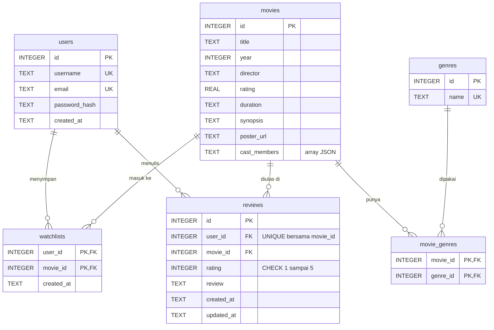

# FilmLog API

Backend untuk aplikasi FilmLog: auth JWT, daftar film, watchlist, review, dan rekomendasi Gemini yang hanya memilih dari film di database. Dibangun dengan Express 5, JavaScript (ESM), dan SQLite lewat libSQL.

Alasan di balik setiap keputusan desain ada di [docs/DECISIONS.md](../docs/DECISIONS.md).

## Prasyarat

- Node.js 22.9 atau lebih baru (dikembangkan dengan Node 24)
- API key Gemini, gratis di [Google AI Studio](https://aistudio.google.com). Tanpa key, semua fitur tetap jalan kecuali rekomendasi, yang membalas 503.

## Menjalankan

```bash
cd backend
npm install
cp .env.example .env     # lalu isi JWT_SECRET dan GEMINI_API_KEY
npm run db:setup         # membuat tabel dan memuat 20 film, aman dijalankan ulang
npm run dev
```

API berjalan di `http://localhost:8000/api`, dokumentasi Swagger di `http://localhost:8000/api/docs`.

Untuk membuat `JWT_SECRET`:

```bash
node -e "console.log(require('crypto').randomBytes(48).toString('hex'))"
```

Untuk mencoba bersama frontend, buka terminal lain:

```bash
cd frontend
npx serve -l 3000 .
```

## Variabel lingkungan

| Nama | Wajib | Bawaan | Keterangan |
|---|---|---|---|
| `JWT_SECRET` | Ya | | Minimal 32 karakter. Server menolak start tanpa ini |
| `GEMINI_API_KEY` | Untuk rekomendasi | | Satu key, atau beberapa dipisah koma (`key1,key2`). Key yang kena limit atau ditolak dilewati otomatis. Tanpa key, `/movies/recommend` membalas 503 |
| `GEMINI_MODEL` | Tidak | `gemini-3.6-flash` | Bisa diganti tanpa mengubah kode |
| `PORT` | Tidak | `8000` | Sama dengan bawaan frontend |
| `DATABASE_URL` | Tidak | `file:./data/filmlog.db` | `libsql://...` untuk Turso |
| `DATABASE_AUTH_TOKEN` | Hanya Turso | | |
| `CORS_ORIGIN` | Tidak | `*` | Semua origin diizinkan. Bisa dibatasi dengan daftar dipisah koma |
| `TRUST_PROXY` | Tidak | `0` | Isi `1` di belakang reverse proxy, agar rate limit membaca IP yang benar |

## Perintah

| Perintah | Fungsi |
|---|---|
| `npm run dev` | Server dengan reload otomatis |
| `npm start` | Server produksi |
| `npm run db:setup` | Migrasi dan seed |
| `npm test` | Semua test, dengan database di memori dan Gemini tiruan, tanpa kuota |
| `npm run eval:recommend` | 15 prompt ke Gemini sungguhan, termasuk prompt injection. Memakai kuota |

## Endpoint

Format error selalu `{ "message": "teks", "details": [...] }`, dengan `details` hanya ada pada error validasi.

| Endpoint | Auth | Sukses | Gagal |
|---|---|---|---|
| `POST /api/auth/register` | | 201 `{ user }` | 400, 409, 429 |
| `POST /api/auth/login` | | 200 `{ token, user }` | 400, 401, 429 |
| `GET /api/movies?genre=&search=&shuffle=true` | | 200 array film | 400 |
| `GET /api/movies/:id` | | 200 film | 400, 404 |
| `POST /api/movies/recommend` | Opsional | 200 `{ movie_id, reasoning }` | 400, 429, 502, 503 |
| `GET /api/watchlist` | Ya | 200 | 401 |
| `POST /api/watchlist` | Ya | 201 | 400, 401, 404, 409 |
| `DELETE /api/watchlist/:movieId` | Ya | 204 | 400, 401, 404 |
| `GET /api/watched` | Ya | 200 | 401 |
| `POST /api/watched` | Ya | 201 baru, 200 diperbarui | 400, 401, 404 |
| `GET /api/health` | | 200 | 500 |

## ERD



## Struktur kode

```text
src/
  server.js        titik masuk: baca env, sambung database, listen
  app.js           merangkai semua komponen, bisa diberi database dan LLM tiruan
  routes/          HTTP dan validasi input, tanpa SQL
  services/        aturan bisnis
  repositories/    semua SQL ada di sini
  llm/             prompt dan klien Gemini
  middleware/      auth, validasi, rate limit, penanganan error
  db/              skema, migrasi, seeder
tests/             integration test per fitur
scripts/           evaluasi rekomendasi dengan Gemini sungguhan
```

## Deployment

Aplikasi berjalan di Railway sebagai satu service, dengan data di Turso. Backend juga menyajikan `frontend/`, jadi frontend dan API berbagi satu domain.

| | URL |
|---|---|
| Frontend | [https://movie-watchlist.up.railway.app/](https://movie-watchlist.up.railway.app/) |
| API | [https://movie-watchlist.up.railway.app/api](https://movie-watchlist.up.railway.app/api/health) |
| Swagger | [https://movie-watchlist.up.railway.app/api/docs](https://movie-watchlist.up.railway.app/api/docs) |

Cara men-deploy ulang:

1. Buat database di Turso, lalu catat URL `libsql://...` dan token-nya. Tabel dan 20 film dibuat otomatis saat start.
2. Di Railway, buat service dari repo ini. Root Directory dikosongkan, bukan diisi `backend`, karena seeder membaca `data/movies.json` di luar folder itu. `package.json` di root meneruskan build dan start ke `backend/`, jadi kedua perintah itu tidak perlu diisi.
3. Isi variabel `JWT_SECRET`, `DATABASE_URL`, `DATABASE_AUTH_TOKEN`, `GEMINI_API_KEY` (boleh beberapa, dipisah koma), dan `TRUST_PROXY=1`.
4. Atur healthcheck ke `/api/health`, lalu buat domain publik.

Turso dipakai karena disk container di Railway tidak permanen, sehingga berkas SQLite lokal akan hilang setiap deploy.

Kalau model bawaan `gemini-3.6-flash` tidak tersedia untuk API key Anda, ganti `GEMINI_MODEL` dengan model Flash lain tanpa mengubah kode.

## Tautan

- Aplikasi live: [https://movie-watchlist.up.railway.app](https://movie-watchlist.up.railway.app/)
- Swagger: [https://movie-watchlist.up.railway.app/api/docs](https://movie-watchlist.up.railway.app/api/docs)
- Video walkthrough: [Google Drive](https://drive.google.com/file/d/1lKy9x3TeIryZ_Raw4j91pougEUBIEsT2/view?usp=sharing)
